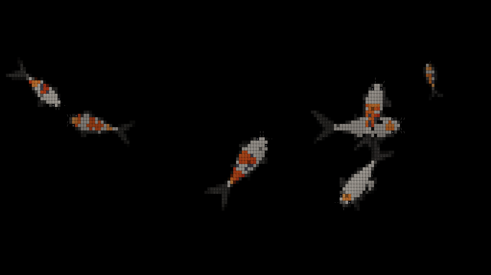

# Omarchy Koi Screensaver

A living ASCII koi pond for [Omarchy](https://omarchy.org), written in Rust. Fish swim, turn,
shoal, dive, and gather around food on a **pure-black background**. The effect is adapted from
the koi pond in [Dao Ho's portfolio](https://github.com/Dao-Ho/portfolio).

It looks like terminal art, but the default Wayland renderer draws its character tiles directly
to a native fullscreen canvas. That preserves the original fish shapes and fine fin details
without stretching large terminal characters. There is also a true ANSI terminal mode.



*Real desktop capture at 2560 × 1440, with 1.25× display scaling; not a mockup.*

> **Status:** Manual launch and dismissal have been tested on a real Omarchy/Hyprland desktop.
> Automatic idle triggering has a separate unresolved session issue; see [Known limitations](#known-limitations).
> This is a screensaver, **not a screen locker** or security boundary.

## What it does

- Animated kohaku, sanke, and tancho koi with body-anchored markings and ASCII texture.
- Travelling body waves, burst-and-coast tail beats, butterfly fins, and loose shoaling.
- Depth shading, wakes, ripples, and splashes when fish eat floating pellets.
- Automatic feeding: the first throw arrives after 12–22 seconds, then every 18–34 seconds.
- Near-square tiles, one-pixel water gutters, and translucent fin veils inspired by the website.
- A 60 FPS target with glyphs rasterized at the monitor's actual pixel density.
- Native dismissal on any key, mouse click, focus loss, or window close; signal handling for shutdown.
- An installer and post-update hook that integrate with Omarchy's existing screensaver launcher.

The installed program runs Rust code with SDL3 and Cairo system libraries. It does **not** launch
a browser or run JavaScript/TypeScript. The original cursor-following and mouse-swipe reactions
are omitted: this pond feeds itself and dismisses when you interact with it.

## Requirements

- Linux with an Omarchy/Hyprland Wayland session for the supported desktop integration.
- A current stable Rust toolchain, Cargo, and a C build toolchain.
- SDL3, Cairo, and `pkg-config` development files (`sdl3`, `cairo`, and `pkgconf` on Arch).
- Omarchy's existing terminal/screensaver setup; the tested terminal is Foot.
- `sudo` access for installation into `/usr/local` and the Omarchy session shim.

On Arch/Omarchy, install missing native build dependencies with:

```bash
sudo pacman -S --needed base-devel sdl3 cairo pkgconf
```

Install Rust separately if `cargo --version` is unavailable. If Rust was installed with rustup,
ensure `~/.cargo/bin` is on `PATH`.

## Install and launch

```bash
git clone https://github.com/aarsh21/omarchy-koi-screensaver.git
cd omarchy-koi-screensaver
./install.sh install
omarchy-launch-screensaver force
```

The repository is currently private, so cloning requires an authorized GitHub account.
The installer builds a release binary locally; no prebuilt download is required.
Press **any key** or click to leave the native pond. Moving the pointer alone does not dismiss it.

### Try it without installing

From a terminal inside your Wayland session:

```bash
cargo run --release
```

For an actual terminal grid instead of the native canvas:

```bash
KOI_FOCUS_CLASS= cargo run --release -- --terminal
```

The empty `KOI_FOCUS_CLASS` disables the ANSI mode's screensaver-window focus check, so it can run
in your ordinary terminal. Press any key to exit; the terminal's alternate screen, cursor, and
saved input settings are restored. ANSI mode also works without Wayland, but the project is not
a tested cross-platform screensaver package.

### Update or uninstall

To rebuild after pulling changes:

```bash
git pull --ff-only
./install.sh install
```

To remove the integration:

```bash
./install.sh uninstall
```

Uninstall restores the previously recorded session shim target (normally Omarchy's stock
screensaver), removes the installed koi binary and login-shell shim, and removes the post-update
hook. It leaves your source checkout intact.

## How the Omarchy integration works

Omarchy's idle service owns the inactivity timer and invokes `omarchy-launch-screensaver`.
That launcher opens a terminal on each monitor and runs `omarchy-screensaver` inside it.
In the tested Foot setup, the Rust process opens its fullscreen Wayland canvas above the waiting
terminal host; the host closes when the Rust process exits.

The installer changes only the following integration paths:

| Path | Purpose |
| --- | --- |
| `/usr/local/bin/koi-screensaver` | Compiled Rust executable |
| `/usr/local/bin/omarchy-screensaver` | Symlink for login-shell command resolution |
| `/usr/share/omarchy/bin/omarchy-screensaver` | Session shim redirected to the koi executable |
| `/usr/local/lib/koi-screensaver/stock-shim-target` | Original session shim target for uninstall |
| `~/.config/omarchy/hooks/post-update.d/koi-screensaver.hook` | Restores the koi shim after Omarchy updates |

The hook uses noninteractive sudo if available; otherwise it notifies you to reinstall manually.
The installer does **not** modify `/usr/bin/omarchy-screensaver`, your terminal font, the launcher,
idle/lock timeouts, or Stay Awake settings. Omarchy retains control of its monitor loop and lock
policy. This project does not replace the lock screen.

## Rendering and code layout

The simulation advances in fixed 1/60-second steps. A shared Rust rasterizer samples each fish
outline into a grid of skin tiles and glyphs; the presentation backend draws that grid.

| File | Responsibility |
| --- | --- |
| [`src/world.rs`](src/world.rs) | Fish movement, shoaling, depth, food, ripples, and seeded randomness |
| [`src/shape.rs`](src/shape.rs) | Body, tail, fin, eye, and barbel classification |
| [`src/render.rs`](src/render.rs) | Tile sampling, markings, shading, glyph selection, and shared palette |
| [`src/native.rs`](src/native.rs) | SDL3 Wayland canvas and Cairo glyph atlas |
| [`src/term.rs`](src/term.rs) | ANSI true-color output and changed-cell diffing |
| [`src/main.rs`](src/main.rs) | Backend selection, timing, feeding, input, signals, and diagnostics |

Native tile width follows the website's `round(width / 125)` rule, clamped to 8–12 logical pixels;
tile height is width + 2. At 2560 × 1440 with 1.25× scaling, that produces a 2048 × 1152 logical
canvas and 171 × 83 tiles, drawn into a full-resolution 2560 × 1440 buffer. Glyphs are cached at
the physical output density and copied 1:1; gutters snap to physical pixels.

The earlier ANSI-only version sampled this desktop at just 142 × 39 cells and lost important fin
details. Native rendering preserves the finer geometry without changing the terminal's font.
The ANSI fallback still uses terminal-sized cells, so its appearance depends on your font and
window dimensions. Both backends use the original `t%SX8@#` skin-glyph vocabulary.

## Configuration

Configuration uses environment variables; there is no configuration file.

| Variable | Default | Meaning |
| --- | --- | --- |
| `KOI_FPS` | `60` | Frame-rate cap, clamped to 5–240 |
| `KOI_SEED` | Current time | Unsigned integer seed for a reproducible simulation |
| `KOI_FEED` | `0` | Positive value sets the nominal interval after the first throw, randomized to 70–130%; otherwise 18–34 seconds |
| `KOI_EXIT_AFTER` | `0` | Exit after this many seconds; zero disables the timer |
| `KOI_STATS` | Unset | Append JSON-lines statistics every five seconds, including backend, FPS, grid, and native pixel size |
| `KOI_SIZE` | Terminal dimensions | Force `COLSxROWS` in ANSI/headless mode only |
| `KOI_CELL_ASPECT` | Measured when available | Force cell height ÷ width in ANSI/headless mode only |
| `KOI_FOCUS_CLASS` | `org.omarchy.screensaver` | Expected focused Hyprland class in ANSI mode; empty disables that check |
| `KOI_DUMP_FRAMES` | Unset | Write a single plain-text frame to this path, then exit without opening a window |
| `KOI_DUMP_SECONDS` | `6` | Simulated seconds before the headless frame is captured |

Examples:

```bash
# A seeded, time-limited native preview with performance statistics.
KOI_SEED=42 KOI_EXIT_AFTER=15 KOI_STATS=/tmp/koi.jsonl cargo run --release

# A headless text frame; no compositor or terminal required.
KOI_SEED=42 KOI_SIZE=190x53 KOI_DUMP_FRAMES=/tmp/koi-frame.txt cargo run --release
```

## Development and testing

```bash
cargo fmt --check
cargo test --release
cargo clippy --release --all-targets -- -D warnings
```

The nine integration tests cover swimming bounds over two simulated minutes, feeding, rendered
tiles and fin veils, pure-black water, ANSI diff output, a frame-time budget, and fidelity to the
original shape classifier. The shape fixture contains **5,166 samples** generated from the
portfolio's TypeScript implementation; tests also check the JavaScript-compatible texture hash.

TypeScript/Bun are only needed to regenerate that fixture, not to build, test, or run Rust:

```bash
git clone https://github.com/Dao-Ho/portfolio /tmp/dao-portfolio
git -C /tmp/dao-portfolio checkout 7fe372a1bd1308b8683e2e97bc6fe51522e2912f
bun scripts/gen-shape-reference.ts > tests/fixtures/shape-reference.csv
```

The generator currently imports the reference from that exact `/tmp/dao-portfolio` location.
The command pins the upstream revision used for this port so the fixture remains reproducible.

### Real-desktop checks

After installation, `bash scripts/smoke.sh` exercises the actual Omarchy launcher, verifies the
running executable, captures a screenshot, sends a dismissal key, and checks that the windows close.
It requires `jq`, `grim`, and `wtype` in addition to Omarchy's existing tools.

For the longer diagnostic capture:

```bash
KOI_SKIP_IDLE=1 bash scripts/proof.sh
```

**This is an interactive system test, not a read-only unit test.** It reinstalls the binary,
opens/closes desktop windows, captures your display, and changes focus. Additional tools include
`script` (util-linux) and ImageMagick; recording is optional when `gpu-screen-recorder` is present.
Artifacts default to `~/.amp/in/artifacts/koi-proof/`; override with `KOI_PROOF_DIR`.
The longer script assumes Foot and targets a Helium browser window for its focus-loss control;
inspect and adapt those development-session assumptions before using it on another desktop.

Without `KOI_SKIP_IDLE=1`, the proof script also temporarily changes idle settings and Stay Awake,
then attempts to restore them on exit. `idle-capture.sh` and `stock-idle-control.sh` are advanced
session diagnostics with similar side effects. `idle-diag.sh` additionally targets a specific
mouse device from the development machine: inspect and adapt it before use. Diagnostic logs are
not a substitute for checking their outcomes; a completed script alone does not prove every phase passed.

## Known limitations

- **Idle triggering:** Manual launch works. In the development session, automatic idle launch
  failed even with the stock screensaver and Stay Awake disabled. That session-level issue remains
  unresolved; this repository does not claim to fix it. Stay Awake normally suppresses idle timers,
  so check that first if manual launch works but automatic launch does not.
- **Desktop coverage:** Tested on one Hyprland monitor at 2560 × 1440 and 1.25× scaling with Foot.
  Other compositors, terminals, and simultaneous multi-monitor focus behavior are not verified.
- **Integration compatibility:** The installer relies on Omarchy's current shim and hook layout.
  Future Omarchy changes may require an integration update.
- **Visual differences:** The fish simulation and rasterizer are ported from the website, but
  Cairo and browser fonts are not pixel-identical. Pure black is a deliberate change from the
  website's charcoal background.

## Credits and licensing status

The original koi effect is by **Dao Ho**, from
[`Dao-Ho/portfolio`](https://github.com/Dao-Ho/portfolio), specifically
[`src/app/components/koi-pond/`](https://github.com/Dao-Ho/portfolio/tree/7fe372a1bd1308b8683e2e97bc6fe51522e2912f/src/app/components/koi-pond).
This project is a derivative Rust port with Omarchy integration, native Wayland presentation,
automatic feeding, and a black background. It is not an official Omarchy or Dao Ho project.

No license file or GitHub-recognized license was found in the upstream repository when preparing
this repository. **No open-source license is granted here for the upstream-derived code.** Keep
the repository private until the relevant permission or licensing terms have been established;
public availability of the original source alone is not permission to redistribute it under a new license.
