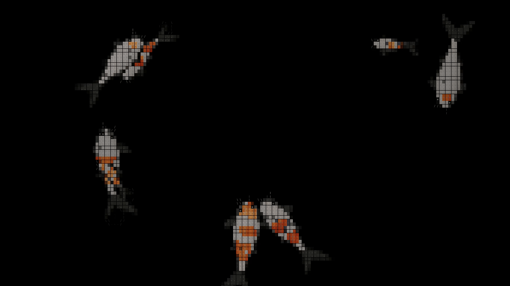

# Omarchy Koi Screensaver

A living ASCII koi pond for [Omarchy](https://omarchy.org), written in Rust. Fish swim, turn,
shoal, dive, and gather around food on a **pure-black background**. The effect is adapted from
the koi pond in [Dao Ho's portfolio](https://github.com/Dao-Ho/portfolio).

It looks like terminal art, but the default Wayland renderer draws its character tiles directly
to a native fullscreen canvas. That preserves the original fish shapes and fine fin details
without stretching large terminal characters. There is also a true ANSI terminal mode.



*Real desktop recording, reduced to 1280 × 720 at 15 FPS for this GIF. The native pond runs at
2560 × 1440 with 1.25× display scaling and a 60 FPS target; not a mockup.
[Full-resolution screenshot](docs/assets/koi-pond.png).*

> **Status:** Tested on a real Omarchy/Hyprland desktop, including automatic idle launch after the
> [Quickshell idle workaround](#quickshell-idle-workaround), native dismissal, feeding, and a
> physical monitor plus a virtual second output. The launcher opens **one window per monitor**,
> without an extra terminal host.
> This is a screensaver, **not a screen locker** or security boundary.

## What it does

- Animated kohaku, sanke, and tancho koi with body-anchored markings and ASCII texture.
- Travelling body waves, burst-and-coast tail beats, butterfly fins, and loose shoaling.
- Depth shading, wakes, ripples, and splashes when fish eat floating pellets.
- Automatic feeding: the first throw arrives after 12–22 seconds, then every 18–34 seconds.
- Near-square tiles, one-pixel water gutters, and translucent fin veils inspired by the website.
- A 60 FPS target with glyphs rasterized at the monitor's actual pixel density.
- Native dismissal on any key, mouse click, focus loss, or window close; signal handling for shutdown.
- Multi-monitor launch with one native pond per output; focusing another pond keeps them open,
  while dismissing one closes the group. Repeated launch requests do not add duplicate ponds.
- An installer and post-update hook that integrate with Omarchy's existing screensaver launcher.

The installed program runs Rust code with SDL3 and Cairo system libraries. It does **not** launch
a browser or run JavaScript/TypeScript. The original cursor-following and mouse-swipe reactions
are omitted: this pond feeds itself and dismisses when you interact with it.

## Requirements

- An Omarchy/Hyprland Wayland session, internet access, `curl`, and `tar`.
- Omarchy's current session-shim layout. Native mode does not need a terminal; Foot is tested for ANSI mode.
- `sudo` access for installation into `/usr/local` and the Omarchy session shim.

Building requires Rust 1.89+. The installer checks for Rust, a C build toolchain, SDL3, Cairo, and `pkg-config`, and installs
missing Arch packages with `pacman -S --needed --noconfirm`. If rustup is already installed but
has no working toolchain, it installs stable Rust for this build without changing your chosen
default toolchain. Package installation may ask for your sudo password.

The supported layout has `omarchy-screensaver` and `omarchy-launch-screensaver` session symlinks
under `/usr/share/omarchy/bin/`, with stock executables under `/usr/bin/`, as tested on Omarchy 4.0.6.
Legacy layouts are refused rather than overwritten. Monitor dimensions and scaling are detected at runtime, not copied from
the development machine.

## Install and launch

Run this as your **normal desktop user, without sudo**:

```bash
curl -fsSL https://raw.githubusercontent.com/aarsh21/omarchy-koi-screensaver/main/setup.sh | bash
```

This downloads the latest source to a temporary directory, installs missing build dependencies,
builds the Rust release binary locally, installs the Omarchy integration, and removes the temporary
source afterward. Building can take several minutes. No GitHub login, Git checkout, or prebuilt
binary is required. Your fonts, idle/lock settings, and stock screensaver executable are untouched.
It does not start the screensaver or enable idle timers automatically.

Then preview it:

```bash
omarchy-launch-screensaver force
```

Press **any key** or click to leave the native pond. Moving the pointer alone does not dismiss it.
For automatic launch, keep `idle.screensaver` positive and turn off **Stay Awake** if you want your
configured idle screensaver and lock timers enabled (`omarchy-toggle-idle allow-idle`). Media
inhibitors and ongoing input legitimately postpone idle. For the tested Quickshell bug, see the
[idle workaround](#quickshell-idle-workaround).

As with any `curl | bash` installer, inspect [setup.sh](setup.sh) and [install.sh](install.sh) before
running code from the internet. To download and review it first instead:

```bash
curl -fsSL https://raw.githubusercontent.com/aarsh21/omarchy-koi-screensaver/main/setup.sh -o koi-setup.sh
less koi-setup.sh
bash koi-setup.sh
```

### Install from a clone

```bash
git clone https://github.com/aarsh21/omarchy-koi-screensaver.git
cd omarchy-koi-screensaver
./install.sh install
```

Both installation methods use the same dependency checks and integration script. Existing
unrelated screensaver or launcher commands under `/usr/local/bin/` are not overwritten.

### Try it without installing

From a terminal inside your Wayland session:

```bash
cargo run --release
```

For an actual terminal grid instead of the native canvas:

```bash
KOI_FOCUS_CLASS= cargo run --release -- --terminal
```

The empty `KOI_FOCUS_CLASS` disables the ANSI mode's screensaver-window focus check, so it can run
in your ordinary terminal. Press any key to exit; the terminal's alternate screen, cursor, and
saved input settings are restored. ANSI mode also works without Wayland, but the project is not
a tested cross-platform screensaver package.

### Update or uninstall

To update, rerun the same `curl ... | bash` installation command. If you installed from a clone,
you can instead rebuild after pulling changes:

```bash
git pull --ff-only
./install.sh install
```

To remove the integration **without internet access or a source checkout**:

```bash
bash /usr/local/lib/koi-screensaver/install.sh uninstall
```

From a clone, `./install.sh uninstall` works too. The online alternative is:

```bash
curl -fsSL https://raw.githubusercontent.com/aarsh21/omarchy-koi-screensaver/main/setup.sh | bash -s -- uninstall
```

Uninstall restores the original screensaver and launcher session shim targets and removes the koi
binary, its login-shell shims, saved installer, and post-update hook. Reinstalling preserves the
original backups. If you switch to another screensaver or launcher after installing koi,
uninstall leaves that replacement alone. A failed download or build does not replace an
already installed screensaver. Source checkouts and installed build dependencies are retained.

## How the Omarchy integration works

Omarchy's idle service owns the inactivity timer and invokes `omarchy-launch-screensaver`.
The installed Rust launcher starts one native fullscreen pond per monitor, **without opening a
terminal**. A background supervisor owns those child processes, prevents duplicate launches with
a session-local lock, and closes the group when a pond exits. It only signals its own children.
Switching focus between ponds is allowed; switching to a normal application dismisses them.

The earlier integration used Omarchy's stock terminal launcher. Frame-by-frame inspection showed
a blank Foot window followed by a second native window and a desktop flash. Redirecting the
launcher itself removes the extra window rather than concealing it.

The installer changes only the following integration paths:

| Path | Purpose |
| --- | --- |
| `/usr/local/bin/koi-screensaver` | Compiled Rust executable |
| `/usr/local/bin/omarchy-screensaver` | Symlink for login-shell command resolution |
| `/usr/share/omarchy/bin/omarchy-screensaver` | Session shim redirected to the koi executable |
| `/usr/local/bin/omarchy-launch-screensaver` | Login-shell alias for the native multi-monitor launcher |
| `/usr/share/omarchy/bin/omarchy-launch-screensaver` | Session alias used by Omarchy's idle service |
| `/usr/local/lib/koi-screensaver/stock-shim-target` | Original session shim target for uninstall |
| `/usr/local/lib/koi-screensaver/stock-launcher-target` | Original launcher shim target for uninstall |
| `/usr/local/lib/koi-screensaver/install.sh` | Saved installer for offline removal |
| `~/.config/omarchy/hooks/post-update.d/koi-screensaver.hook` | Restores the koi shim after Omarchy updates |

The hook restores only shims reset to Omarchy's stock targets, not later custom replacements.
It uses noninteractive sudo if available; otherwise it notifies you to reinstall manually.
The installer does **not** modify the stock `/usr/bin/` executables, your font, idle/lock timeouts,
Stay Awake, or the idle service. Omarchy retains its timer and lock policy. This project does not
replace the lock screen. The optional workaround below is separate from normal installation.

### Quickshell idle workaround

On Omarchy 4.0.6 with Quickshell `0.3.2.r7.g2b4501a`, changing the timeout can leave `IdleMonitor.isIdle`
stale: the Wayland notifier reports idle, but QML still reports active. This was reproduced both in
the real idle service and in a minimal Quickshell process. The native pond is not the cause.

[`scripts/idle-monitor.patch`](scripts/idle-monitor.patch) recreates the monitor object when it is
enabled or its timeout changes. It retains `respectInhibitors: true` and leaves the screensaver,
lock deadlines, and dismissal policy unchanged. Real automatic launch, Stay Awake, the disabled
screensaver flag, and a compositor idle inhibitor have been exercised with the workaround.

**Optional, for affected installations only:** inspect the patch and apply it from a clone while
the session is unlocked. It changes Omarchy's idle service, so normal `setup.sh` deliberately does
not apply it silently. The command refuses fuzzy context matches and saves a backup:

```bash
sudo patch --forward --fuzz=0 --backup --suffix=.koi-backup \
  /usr/share/omarchy/shell/plugins/services/idle/Service.qml < scripts/idle-monitor.patch
omarchy-restart-shell
```

If the patch does not match your version, stop rather than forcing it. To reverse this specific
workaround (also from the clone, unlocked):

```bash
sudo patch --reverse --fuzz=0 \
  /usr/share/omarchy/shell/plugins/services/idle/Service.qml < scripts/idle-monitor.patch
omarchy-restart-shell
```

An Omarchy update may replace the service; reassess whether the workaround is still needed.
Normal koi uninstall does not revert this separately applied service patch. Continuous input,
media inhibitors, and Stay Awake still prevent idle by design; this patch does not bypass them.

## Rendering and code layout

The simulation advances in fixed 1/60-second steps. A shared Rust rasterizer samples each fish
outline into a grid of skin tiles and glyphs; the presentation backend draws that grid.

| File | Responsibility |
| --- | --- |
| [`src/world.rs`](src/world.rs) | Fish movement, shoaling, depth, food, ripples, and seeded randomness |
| [`src/shape.rs`](src/shape.rs) | Body, tail, fin, eye, and barbel classification |
| [`src/render.rs`](src/render.rs) | Tile sampling, markings, shading, glyph selection, and shared palette |
| [`src/native.rs`](src/native.rs) | SDL3 Wayland canvas and Cairo glyph atlas |
| [`src/term.rs`](src/term.rs) | ANSI true-color output and changed-cell diffing |
| [`src/main.rs`](src/main.rs) | Backend selection, timing, feeding, input, signals, and diagnostics |

Native tile width follows the website's `round(width / 125)` rule, clamped to 8–12 logical pixels;
tile height is width + 2. At 2560 × 1440 with 1.25× scaling, that produces a 2048 × 1152 logical
canvas and 171 × 83 tiles, drawn into a full-resolution 2560 × 1440 buffer. Glyphs are cached at
the physical output density and copied 1:1; gutters snap to physical pixels.

The earlier ANSI-only version sampled this desktop at just 142 × 39 cells and lost important fin
details. Native rendering preserves the finer geometry without changing the terminal's font.
The ANSI fallback still uses terminal-sized cells, so its appearance depends on your font and
window dimensions. Both backends use the original `t%SX8@#` skin-glyph vocabulary.

## Configuration

Configuration uses environment variables; there is no configuration file.

| Variable | Default | Meaning |
| --- | --- | --- |
| `KOI_FPS` | `60` | Frame-rate cap, clamped to 5–240 |
| `KOI_SEED` | Current time | Unsigned integer seed for a reproducible simulation |
| `KOI_FEED` | `0` | Positive value sets the nominal interval after the first throw, randomized to 70–130%; otherwise 18–34 seconds |
| `KOI_EXIT_AFTER` | `0` | Exit after this many seconds; zero disables the timer |
| `KOI_STATS` | Unset | Append JSON-lines statistics every five seconds, including backend, FPS, grid, and native pixel size |
| `KOI_SIZE` | Terminal dimensions | Force `COLSxROWS` in ANSI/headless mode only |
| `KOI_CELL_ASPECT` | Measured when available | Force cell height ÷ width in ANSI/headless mode only |
| `KOI_FOCUS_CLASS` | `org.omarchy.screensaver` | Expected focused Hyprland class; empty disables the class-based focus check |
| `KOI_MONITOR` | Focused output | Native output name; the multi-monitor launcher sets this for each child |
| `KOI_DUMP_FRAMES` | Unset | Write a single plain-text frame to this path, then exit without opening a window |
| `KOI_DUMP_SECONDS` | `6` | Simulated seconds before the headless frame is captured |

Examples:

```bash
# A seeded, time-limited native preview with performance statistics.
KOI_SEED=42 KOI_EXIT_AFTER=15 KOI_STATS=/tmp/koi.jsonl cargo run --release

# A headless text frame; no compositor or terminal required.
KOI_SEED=42 KOI_SIZE=190x53 KOI_DUMP_FRAMES=/tmp/koi-frame.txt cargo run --release
```

## Development and testing

```bash
cargo fmt --check
cargo test --release
cargo clippy --release --all-targets -- -D warnings
```

The nine integration tests cover swimming bounds over two simulated minutes, feeding, rendered
tiles and fin veils, pure-black water, ANSI diff output, a frame-time budget, and fidelity to the
original shape classifier. The shape fixture contains **5,166 samples** generated from the
portfolio's TypeScript implementation; tests also check the JavaScript-compatible texture hash.

Eight additional installer tests run on Omarchy with Python and Bubblewrap:

```bash
python3 -m unittest discover -s tests -p test_setup.py -v
```

These stream the real setup script into Bash in network-isolated sandboxes with the host filesystem
read-only. They cover install/reinstall, offline removal, download/build failures, dependency
selection, rustup, foreign shim protection, and the post-update hook. Package installation,
compilation, and HTTP are simulated; extraction and filesystem operations are real. Neither Python
nor Bubblewrap is required by the installer itself.

TypeScript/Bun are only needed to regenerate that fixture, not to build, test, or run Rust:

```bash
git clone https://github.com/Dao-Ho/portfolio /tmp/dao-portfolio
git -C /tmp/dao-portfolio checkout 7fe372a1bd1308b8683e2e97bc6fe51522e2912f
bun scripts/gen-shape-reference.ts > tests/fixtures/shape-reference.csv
```

The generator currently imports the reference from that exact `/tmp/dao-portfolio` location.
The command pins the upstream revision used for this port so the fixture remains reproducible.

### Real-desktop checks

After installation, `bash scripts/smoke.sh` exercises the actual Omarchy launcher, verifies the
running executable, requires exactly one window per output, captures a screenshot, checks focus
between ponds, and verifies dismissal. It also tests duplicate active requests and rapid reopen.
It requires `jq`, `grim`, and `wtype` in addition to Omarchy's existing tools.

On the development desktop, the latest checks observed:

- Before/after launch recordings at 2560 × 1440 and 60 FPS, with all 476 frames of each inspected:
  the old Foot-plus-pond sequence became one native window, without a terminal or desktop flash.
- Four duplicate launch requests kept one pond; three immediate reopen/dismiss cycles succeeded.
- A physical output plus a virtual second output each received one pond. Moving focus between
  ponds kept both alive; dismissing one closed the group without leftover processes.
- A 30-second installed-binary capture reported 59.7–59.9 FPS, a 171 × 83 tile grid, and a
  2560 × 1440 native buffer. Automatic feeding appeared in the 20-second sample.
- Real key, mouse-click, focus-loss, and SIGTERM dismissal succeeded. ANSI mode restored the
  exact saved terminal settings, alternate screen, and cursor.
- With the separate idle workaround, automatic launch succeeded repeatedly; Stay Awake, the
  screensaver-off flag, and a real compositor inhibitor still suppressed it as intended.

The original idle and lock deadlines and Stay Awake choice were restored afterward. Secure lock
and password authentication were **not** exercised; this evidence does not establish lock-screen
security or compatibility with untested hardware.

For the longer diagnostic capture:

```bash
KOI_SKIP_IDLE=1 bash scripts/proof.sh
```

**This is an interactive system test, not a read-only unit test.** It reinstalls the binary,
opens/closes desktop windows, captures your display, and changes focus. Additional tools include
`script` (util-linux) and ImageMagick; recording is optional when `gpu-screen-recorder` is present.
Artifacts default to `~/.amp/in/artifacts/koi-proof/`; override with `KOI_PROOF_DIR`.
The stock-screen control uses Foot; start the script with a normal application focused so the
focus-loss check can return to that window. Required phases fail with a nonzero exit status;
`KOI_SKIP_IDLE=1` explicitly skips idle rather than passing it. Run idle checks on an actually
inactive desktop with inhibitors accounted for, not while typing or moving the mouse.

Without `KOI_SKIP_IDLE=1`, the proof script also temporarily changes idle settings and Stay Awake,
then restores the fields it changes on exit. `idle-capture.sh` and `stock-idle-control.sh` are advanced
session diagnostics with similar side effects. `idle-diag.sh` additionally targets a specific
mouse device from the development machine: inspect and adapt it before use. Diagnostic logs are
not a substitute for checking their outcomes; a completed script alone does not prove every phase passed.

## Known limitations

- **Idle dependency:** The affected Quickshell version needs the explicit workaround above.
  This project does not silently patch Omarchy's lock/idle service or override user inhibitors.
- **Desktop coverage:** Tested on a physical 2560 × 1440 output at 1.25× scaling and a temporary
  1280 × 720 virtual second output. Two physical monitors, other compositors, and other hardware
  have not been tested. Outputs are enumerated at launch; relaunch after changing the output set.
- **Integration compatibility:** The installer relies on Omarchy's current shim and hook layout.
  Future Omarchy changes may require an integration update.
- **Visual differences:** The fish simulation and rasterizer are ported from the website, but
  Cairo and browser fonts are not pixel-identical. Pure black is a deliberate change from the
  website's charcoal background.

## Credits and licensing status

The original koi effect is by **Dao Ho**, from
[`Dao-Ho/portfolio`](https://github.com/Dao-Ho/portfolio), specifically
[`src/app/components/koi-pond/`](https://github.com/Dao-Ho/portfolio/tree/7fe372a1bd1308b8683e2e97bc6fe51522e2912f/src/app/components/koi-pond).
This project is a derivative Rust port with Omarchy integration, native Wayland presentation,
automatic feeding, and a black background. It is not an official Omarchy or Dao Ho project.

No license file or GitHub-recognized license was found in the upstream repository when preparing
this repository. **No open-source license is granted here for the upstream-derived code.** Public
availability of this port does not supply missing upstream permissions or authorize relicensing.
Check the upstream terms or obtain permission before redistributing or relicensing the derived code.
